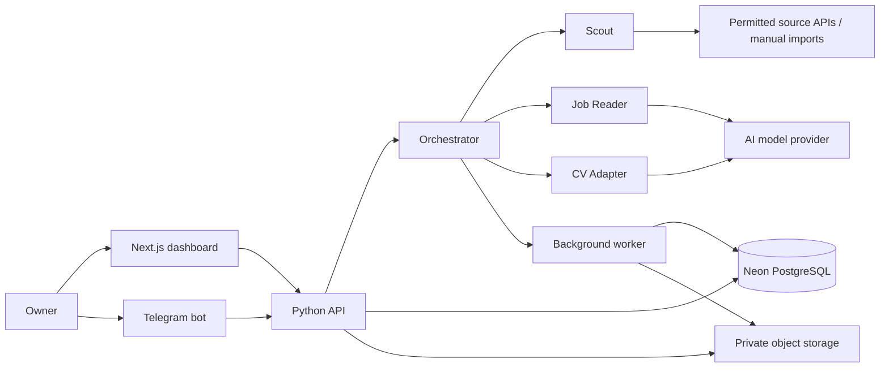

# Architecture

## System outline

The product is a single-owner application with three user-facing entry points: a Next.js web dashboard, a Python API/worker, and a Telegram bot. The Python orchestrator coordinates three sequentially bounded stages: Scout, Job Reader, and CV Adapter. Long-running search and document tasks are persisted and processed asynchronously.



## Recommended stack

| Layer | Recommendation | Notes |
| --- | --- | --- |
| Web | Next.js 16.4.x App Router, TypeScript | Dashboard and server-rendered pages. Use current patched 16.x release when implementation begins. |
| Runtime | Node.js 20.9+ | Next.js 16 baseline requirement. |
| API and workflow | Python 3.14.10, FastAPI 0.162.0 | REST API, Telegram webhook/polling adapter, orchestration, and background worker code. Pin compatible exact dependencies at implementation. |
| Database | Neon PostgreSQL 18 | Relational source of truth for profiles, jobs, runs, matches, statuses, and file metadata. |
| File storage | Private S3-compatible object storage | Provider is undecided. Store originals and generated CV/cover-letter files outside the public web root and DB. |
| AI | NVIDIA Build through an OpenAI-compatible model adapter | Used for local scoring and tailoring. Production use with real profile data depends on privacy and retention review; model and cost can be revisited if needed. |
| Source access | Approved APIs/feeds and manual imports | No LinkedIn or Upwork scraping, session-cookie reuse, or access-control circumvention. |

Versions were checked against the official [Python release page](https://www.python.org/downloads/release/python-31410/), [FastAPI release notes](https://fastapi.tiangolo.com/release-notes/), [Next.js release log](https://nextjs.org/blog), [Next.js support policy](https://nextjs.org/support-policy), and [Neon Postgres version reference](https://api-docs.neon.tech/reference/createproject) on 2026-11-07. Next.js 16.x is Active LTS; Neon lists PostgreSQL 18 as supported.

## Application boundaries

### Web application

- Owns dashboard rendering, email/password sign-in screens, CV upload/review, job search controls, match review, status actions, and document downloads.
- Calls the Python API over HTTPS; it does not call AI providers or job sources directly from the browser.
- Keeps secrets and privileged source/AI credentials server-side.

### Python API and orchestrator

- Enforces the one-owner authorization boundary.
- Exposes versioned JSON endpoints described through OpenAPI.
- Validates uploads/imports and creates durable records before starting lengthy work.
- Runs the Scout -> Job Reader -> CV Adapter pipeline, retaining stage state and warnings.
- Provides a Telegram integration adapter that maps bot commands to authorized application actions.

### Background worker

- Performs permitted job searches, parsing/scoring, CV conversion/tailoring, and cover-letter generation.
- Uses persisted run/stage records so work survives process restarts.
- Uses idempotency keys for source jobs and generated-material tasks.
- Retries transient network/provider errors with bounded backoff; permanent access, parsing, or validation failures become visible warnings.
- Queue technology and worker hosting remain undecided; choose them after the deployment provider and cost limits are selected.

### Data and files

- Neon PostgreSQL is the source of truth for confirmed profile facts, job records, scores, statuses, run state, and metadata.
- Private object storage holds original CVs and generated documents. DB records contain storage keys, format, version, and ownership metadata, not file bytes.
- The original CV is immutable. Each tailored document points to its source CV and job.
- Authenticated, short-lived downloads or signed URLs protect private files.

## Proposed repository structure

```text
job-hunter/
├── apps/
│   ├── web/                         # Next.js dashboard
│   │   ├── app/                      # App Router pages, layouts, route handlers
│   │   │   ├── (auth)/               # Sign-in and account provisioning
│   │   │   ├── (dashboard)/          # Protected app screens
│   │   │   │   ├── jobs/             # Search runs, matches, job details
│   │   │   │   ├── profile/          # Confirmed profile and target preferences
│   │   │   │   └── documents/        # CV library and generated materials
│   │   │   └── api/                  # Thin web callbacks only when needed
│   │   ├── components/               # Shared UI components
│   │   ├── features/                 # Dashboard feature modules
│   │   ├── lib/                      # API client, auth helpers, formatting
│   │   └── public/                   # Static assets only; no private CVs
│   └── api/                          # uv-managed Python API and worker project
│       ├── src/
│       │   └── api/
│       │       ├── auth/             # Session verification and owner policy
│       │       ├── config/           # Settings and environment parsing
│       │       ├── db/               # DB session, models, repositories
│       │       ├── domain/            # Core entities, enums, validation rules
│       │       ├── integrations/
│       │       │   ├── ai/           # Provider interface and adapters
│       │       │   ├── linkedin/     # Permitted access adapter only
│       │       │   ├── upwork/       # Approved API adapter only
│       │       │   ├── telegram/     # Bot commands, callbacks, account linking
│       │       │   └── storage/      # Private object-storage adapter
│       │       ├── routes/           # HTTP route modules (jobs, profile, documents)
│       │       ├── schemas/          # Pydantic API request/response models
│       │       ├── services/
│       │       │   ├── orchestrator/ # Run coordination and state transitions
│       │       │   ├── scout/        # Source search and manual import
│       │       │   ├── job_reader/   # Tech filter, score, explanation
│       │       │   └── cv_adapter/   # Fact-grounded CV and letter generation
│       │       ├── workers/          # Async job entry points and retry policy
│       │       └── main.py           # API application entry point
│       ├── migrations/               # Versioned PostgreSQL migrations
│       ├── pyproject.toml
│       └── uv.lock
├── packages/
│   └── api-client/                   # Generated/typed client contract for web
├── docs/                             # Supporting product, operations, decisions
├── infra/                            # Deployment manifests and environment templates
├── scripts/                          # Local setup and maintenance commands
├── .env.example                      # Names and descriptions only; no secrets
├── ARCHITECTURE.md
├── PLAN.md
└── PRD.md
```

This is a target structure, not a set of files or directories created by this document. Keep modules small initially; split services into separate deployable processes only where runtime needs require it.

## Core data model

```text
Account (single owner)
  ├── Profile (confirmed facts and preferences)
  ├── CVDocument (original)
  │     └── CVDocument (tailored version, per job)
  ├── SearchRun
  │     └── SearchSourceAttempt
  └── Job
        ├── Match (score, reasons, gaps, warnings)
        ├── ApplicationPackage (CV + cover letter versions)
        └── JobStatus (new / saved / dismissed / applied)
```

Important constraints:

- Every record is scoped to the single owner; authorization is enforced in the API even though v1 has one account.
- Deduplicate a job on `(source, external_job_id)` when available; otherwise use a normalized `(source, source_url)` key.
- A `Match` score is a floating-point rating from 1.0 to 5.0, rounded to one decimal place. All scored jobs are returned and shown, including scores below 4.
- Job status is shared between the dashboard and Telegram.
- Generated files reference both the original CV and job so they can be deleted or regenerated without changing the source.
- Store stage state, timestamps, attempt count, and failure/warning codes for each search/material operation.

## Main workflow and failure behavior

1. Create a `SearchRun` with command, location/mode, and source attempts.
2. Scout queries only approved source interfaces. If unavailable, report source failure and allow URL/description import.
3. Normalize and deduplicate returned/imported jobs.
4. Job Reader determines tech relevance, score, rationale, and uncertainty. Show every scored job and its rating.
5. CV Adapter prepares per-job CV and cover letter from confirmed facts. Keep generated statements traceable to profile/source facts.
6. Store files privately and link them to the job/application package.
7. Present the result and warning state in web and Telegram. User opens the platform and submits manually.

If the reader is uncertain, show the job with a warning at any score. If tailoring fails, show the job with a warning and no fabricated or partial document presented as complete. Search stage failures should not erase successful results from other sources.

## API and integration contracts

- Web-to-API: HTTPS JSON REST with OpenAPI contract; job searches return a run ID and clients poll run state/results.
- Telegram-to-API: Telegram Bot API webhook or long polling, chosen to match hosting. Link bot identity to the owner using a short-lived one-time code (assumption to confirm during implementation).
- AI: provider adapter accepts only the minimum required profile/job context, requests structured output, validates claims, and records provider/model metadata without logging CV text.
- LinkedIn: no crawler or browser automation. Use an interface explicitly authorized for the intended job data; public Job Library coverage may be limited.
- Upwork: request API approval and confirm job-search capability and permissions before coding the source adapter. If access is unavailable, use manual import.
- Storage: private bucket, server-side authorization, signed downloads, and deletion of derived objects when the source CV is deleted.

Current platform references: [LinkedIn prohibited software guidance](https://www.linkedin.com/help/linkedin/answer/a1341387/prohibited-software-and-extensions), [LinkedIn Job Library](https://www.linkedin.com/help/linkedin/answer/a7451373), [Upwork automation policy](https://support.upwork.com/hc/en-us/articles/43342677368467-Use-bots-and-other-automation-properly), [Upwork developer space](https://www.upwork.com/developer).

## Security and privacy

- Restrict account provisioning to the owner; no public multi-user sign-up in v1.
- Hash passwords with a current password-hashing library and protect sessions with secure, HTTP-only cookies.
- Authorize every API route, bot callback, file lookup, and status update.
- Store API keys in managed secrets; never commit real credentials.
- Validate file extensions, MIME types, size, and parser result; treat uploaded documents and job descriptions as untrusted input.
- Keep private files out of `public/`, logs, and static deployment assets.
- Avoid prompt injection from job descriptions: source content is data, never trusted instructions to the orchestrator or tools.
- Apply rate limits to login, imports, and search commands; cap AI/file processing usage.
- Record data deletion through DB and object storage; define backup-expiration behavior before launch.

## Environments and deployment

- **Local:** web, API, worker, and bot integration run against development credentials and a development Neon branch/private bucket.
- **Production:** online HTTPS web/API plus worker, managed Neon, private object storage, Telegram webhook or polling, and managed secrets.
- Hosting provider, CI/CD vendor, region, queue, and monitoring product are undecided. Keep deployment configuration portable until those decisions are made.
- Separate development and production secrets, storage buckets, and database branches.

## Architecture decisions still open

1. AI provider/model, retention terms, and budget.
2. Private object-storage and web/API/worker hosting providers.
3. Durable queue choice and retry limits.
4. Approved LinkedIn and Upwork source coverage and rate limits.
5. Account provisioning and Telegram one-time linking implementation.
6. CV parsing/conversion tools and measurable layout-preservation acceptance threshold.
7. Scoring rubric weights and calibration across the 1.0–5.0 rating scale.
