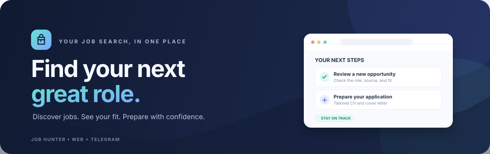
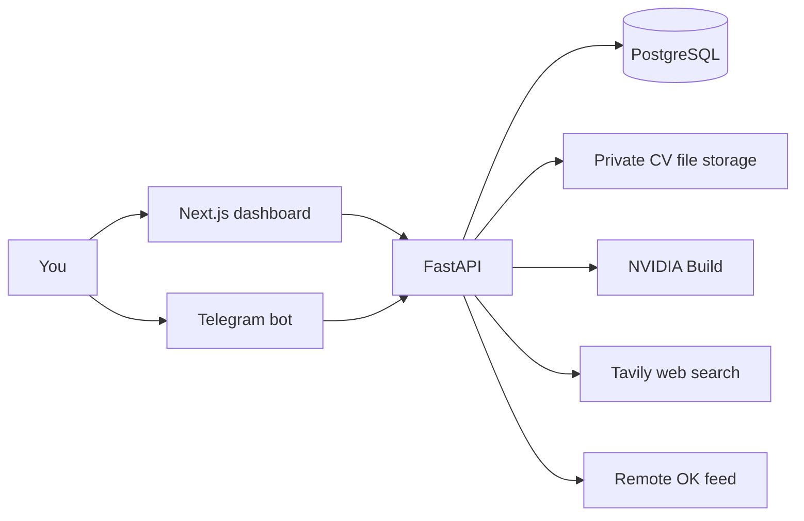

<div align="center">
  

  <br />

  <p>
    <strong>A personal workspace for finding, evaluating, and preparing for your next role.</strong>
    <br />
    Bring your job search, CV tailoring, and application follow-ups into one place.
  </p>

  <p>
    
    
    
    
    
  </p>
</div>

---

## What it does

Job Hunter helps turn a job lead into a reviewed application package. It brings together job discovery, match scoring, tailored documents, and application tracking in a private dashboard, with a Telegram bot for quick searches and updates.

### Find roles

- Search Remote OK roles from the dashboard or Telegram.
- Search for recent on-site IT jobs in Abuja, Lagos, Port Harcourt, Enugu, and Benue State with Telegram's `/site [keywords]` command.
- Import a job yourself when a source is unavailable or its terms do not allow automated access.
- Keep source links and avoid saving the same listing twice.

### Understand the match

- Score a listing from **1.0 to 5.0** after confirming your profile.
- See strengths, gaps, and uncertainty so you can decide whether to pursue it.
- Keep lower-scoring jobs visible instead of silently hiding them.

### Prepare application materials

- Upload a text-based PDF or DOCX CV and review the profile facts extracted from it.
- Generate a tailored CV and cover letter as DOCX or PDF.
- Trace generated claims back to profile facts and review the drafts before using them.
- Keep the original CV unchanged.

### Keep your search organized

- Track jobs as new, saved, dismissed, or applied.
- Add private notes and follow-up dates.
- Use the dashboard or link a private Telegram chat to your account.

## How it fits together



## Tech stack

| Part | Technology |
| --- | --- |
| Web app | Next.js, React, TypeScript |
| API and Telegram bot | Python, FastAPI, SQLAlchemy |
| Database | PostgreSQL, Alembic migrations |
| Job matching and document tailoring | NVIDIA Build API |
| On-site web search | Tavily Search and Extract APIs |
| Remote job source | Remote OK public feed |
| Application documents | DOCX and PDF |

## Run it locally

### Requirements

- Python **3.14 or newer** and [uv](https://docs.astral.sh/uv/)
- Node.js **20.9 or newer** and npm
- A PostgreSQL database, such as a local instance or Neon

### 1. Configure the API

From `apps/api`, copy `.env.example` to `.env`. Set `DATABASE_URL`, `OWNER_EMAIL`, `OWNER_PASSWORD_HASH`, and `SESSION_SECRET`. The API README explains how to generate the password hash and session secret without putting the plain password in a command.

Install dependencies, apply migrations, and start the API:

```powershell
cd apps/api
uv sync
uv run --env-file .env alembic upgrade head
uv run --env-file .env uvicorn api.main:app --reload
```

The API health endpoints are `/health` and `/ready`.

### 2. Start the dashboard

In another terminal, copy `apps/web/.env.example` to `apps/web/.env.local`. Its server-side `API_URL` should point to the API, which defaults to `http://127.0.0.1:8000` for local development.

```powershell
cd apps/web
npm ci
npm run dev
```

Open [http://localhost:3000](http://localhost:3000) and sign in with the owner account configured for the API.

### 3. Enable optional services

- Add `AI_API_KEY` to use match scoring and document tailoring.
- Add `TAVILY_API_KEY` to use the Telegram `/site` search.
- Add `TELEGRAM_BOT_TOKEN` to run the Telegram bot. Start it from `apps/api` in a separate terminal and connect it from the dashboard.

See [`apps/api/README.md`](apps/api/README.md) for API setup, Telegram linking, environment variables, and endpoint details.

## Privacy and safeguards

- The app has a single owner account. Dashboard API requests go through same-origin Next.js routes.
- In local development, uploaded CV files are stored outside the public web directory. Extracted profile facts are stored in PostgreSQL.
- AI requests use selected profile facts and job details; they do not send the uploaded CV file or direct identity fields such as name, email, or phone.
- Job applications are prepared for your review. **The app does not submit applications for you.**
- LinkedIn and Upwork scraping are not part of the app. Use only access permitted by each service; manual import is available as a fallback.
- Review NVIDIA's data-handling terms before sending real profile information to a hosted AI provider.

## Current limitations

- CV extraction supports text-based PDF and DOCX files; scanned-PDF OCR is not included.
- `/site` searches dated pages from the last seven days in its configured Nigerian locations. Publisher dates can be estimates, so confirm the posting date and work mode at the source.
- LinkedIn and Upwork API access is not implemented.
- Private production file storage, hosting, retention, and backup policies still need to be configured before production use.

## Repository layout

```text
apps/
  api/    FastAPI service, Telegram bot, database migrations
  web/    Next.js dashboard
docs/     Project visuals
```

## Project status

Job Hunter is a personal local MVP. Core CV onboarding, scoring, document tailoring, dashboard workflows, and Telegram linking are implemented. Production deployment and privacy review remain separate steps; see [`PLAN.md`](PLAN.md) for the implementation plan.
